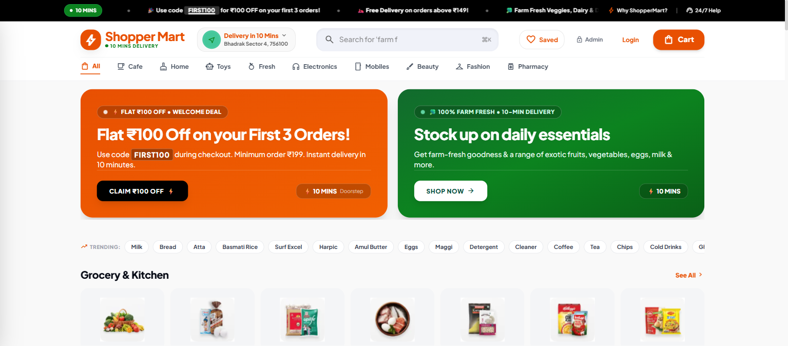
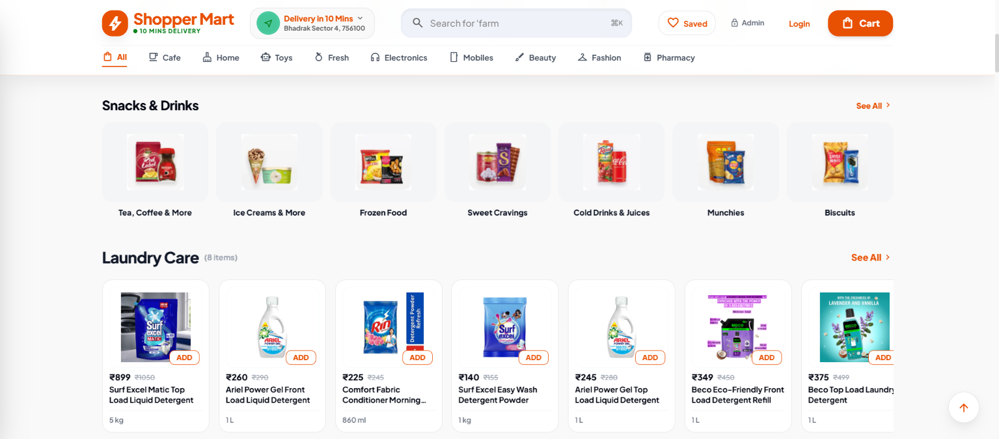

<div align="center">

<!-- 3D Modern Wave Header Banner (No raw ampersands to avoid SVG XML entity errors) -->


[](https://shoppermart.onrender.com/)
[](https://pranayakd.in/)
[](https://github.com/PranayaKD/ShopperMart)
[](https://www.djangoproject.com/)
[](https://www.django-rest-framework.org/)
[](https://www.postgresql.org/)
[](https://razorpay.com/)

<br/>

**A production-ready, full-featured e-commerce and retail inventory platform built with Django 5 and Django REST Framework.**  
Engineered with UUIDv4 primary keys to eradicate IDOR vulnerabilities, atomic multi-item checkout transactions, anonymous-to-authenticated session cart migration, Razorpay payment processing, and an administrative control panel with immutable audit trails.

[Explore Live Store](https://shoppermart.onrender.com/) • [REST API Reference](#-restful-api-architecture) • [Security & Transactions](#-concurrency--security-hardening) • [Database Schema](#-database-architecture)

</div>

---

## 📸 Live Storefront & Application Showcase

<div align="center">
  <h3>Real-Time Live Storefront</h3>
  
</div>

<br/>

<div align="center">
  <h3>Department Catalog & Product Grid</h3>
  
</div>

---

## ⚡ Core Engineering Highlights

```
┌─────────────────────────────────────────────────────────────────────────────┐
│                           SHOPPERMART ARCHITECTURE                          │
├───────────────────────┬──────────────────────────┬──────────────────────────┤
│    Atomic Checkout    │      UUID Security       │    Cart Session Merge    │
│  transaction.atomic() │  UUIDv4 primary keys     │  PreLoginSession tracker │
│  Inventory lock-check │  Zero IDOR exposure      │  Guest cart -> User cart │
│  Razorpay HMAC SHA256 │  Protected endpoints     │  No lost shopping items  │
└───────────────────────┴──────────────────────────┴──────────────────────────┘
```

- **UUIDv4-Backed Domain Modeling**: All entity IDs utilize UUIDv4 rather than auto-incrementing integers, fully shielding product orders, invoices, and user customer profiles from numeric enumeration and IDOR security flaws.
- **Atomic Checkout Engine**: Purchases are wrapped in `transaction.atomic()`, ensuring strict stock reservation, idempotency token validation, price-snapshot locking, and instant rollbacks on payment failure.
- **Session-to-User Cart Migration**: Anonymous guests can freely browse and add items to their local session cart; upon logging in, `PreLoginSessionMiddleware` automatically transfers all items to their persistent user account without item loss.
- **Cryptographic Payment Verification**: Seamless client-side Razorpay modal integration backed by server-side HMAC-SHA256 signature verification.
- **Formal Order State Machine**: Strict status transitions (`pending` → `processing` → `shipped` → `out_for_delivery` → `delivered`) with immutable audit records stored in `OrderStatusLog`.

---

## 🛠️ Complete Tech Stack

| Domain | Technology / Library | Role in ShopperMart |
| :--- | :--- | :--- |
| **Backend Framework** | **Django 5.2+** / Python 3.11+ | Monolithic web application framework & ORM |
| **REST API Engine** | **Django REST Framework (DRF)** | Standardized ViewSets with token auth, filtering, and throttling |
| **Primary Database** | **PostgreSQL (Supabase / Render)** | Relational storage with foreign key constraints and index optimizations |
| **Payment Gateway** | **Razorpay Python SDK** | Server-side order creation and webhook verification |
| **Rate Limiting** | **Django-Ratelimit** | IP-based brute-force defense on authentication routes (`5 req/min`) |
| **Security Headers** | **Django-CSP** | Content Security Policy enforcing strict script and style sources |
| **Authentication** | **Django-Allauth** | Google OAuth 2.0 social login + standard session auth |
| **Frontend Styling** | **Bootstrap 5 & Custom CSS** | Responsive multi-breakpoint catalog, cart drawers, and checkout |
| **Asset Pipeline** | **WhiteNoise & Gunicorn** | Gzip-compressed asset caching and production WSGI worker execution |

---

## 🌐 RESTful API Architecture

ShopperMart exposes clean RESTful endpoints powered by DRF ViewSets with filtering, searching, and pagination:

| HTTP Method | Endpoint | Description | Permissions |
| :--- | :--- | :--- | :---: |
| `GET` | `/api/products/` | Paginated product list with search, category filter, and ordering | AllowAny |
| `GET` | `/api/products/<uuid>/` | Detailed product specifications and verified reviews | AllowAny |
| `GET` | `/api/categories/` | All department categories with active item counts | AllowAny |
| `GET`, `POST` | `/api/cart/` | Retrieve active cart items or add new items | IsAuthenticated |
| `DELETE` | `/api/cart/<item_id>/` | Remove an item or decrement item quantity | IsAuthenticated |
| `GET`, `POST` | `/api/orders/` | Fetch user order history or initiate an order | IsAuthenticated |
| `GET` | `/api/orders/<uuid>/` | Specific order progress status with tracking logs | IsAuthenticated (Owner) |
| `POST` | `/api/wishlist/toggle/` | Add/remove products from user's wishlist | IsAuthenticated |
| `POST` | `/orders/payment/verify/` | Razorpay payment webhook signature validation | Public / Callback |

---

## 🛡️ Concurrency & Security Hardening

1. **Idempotent Checkout**: Every checkout request includes a client idempotency key to prevent accidental duplicate credit card/UPI charges on double-clicks.
2. **Brute-Force Shield**: Authentication and password reset endpoints enforce rate limits via `@ratelimit(key='ip', rate='5/m')`.
3. **Strict Content Security Policy (CSP)**: Disallows unauthorized third-party scripts from executing, mitigating cross-site scripting (XSS).
4. **SQL Injection & XSS Immunity**: 100% parameterization via Django ORM and CSRF token protection on every state-mutating form.

---

## 🚀 Local Installation & Setup

```bash
# 1. Clone repository
git clone https://github.com/PranayaKD/ShopperMart.git
cd ShopperMart

# 2. Set up virtual environment
python -m venv env
source env/bin/activate  # On Windows: .\env\Scripts\activate

# 3. Install dependencies
pip install -r requirements.txt

# 4. Configure environment variables
cp .env.example .env
# Fill in your DATABASE_URL (PostgreSQL), SECRET_KEY, and RAZORPAY credentials

# 5. Execute migrations
python manage.py migrate

# 6. Create superuser administrator
python manage.py createsuperuser

# 7. Start local server
python manage.py runserver
```

Open `http://localhost:8000` to access ShopperMart.

---

## 📄 License & Author

Developed by **[PranayaKD](https://pranayakd.in/)** ([Pranaya Kumar Dash](https://github.com/PranayaKD)).  
Portfolio: **[https://pranayakd.in/](https://pranayakd.in/)**  
Licensed under the [MIT License](LICENSE).

<div align="center">
  <sub>⭐ If you find ShopperMart helpful for your Django or e-commerce studies, please star the repo!</sub>
</div>
